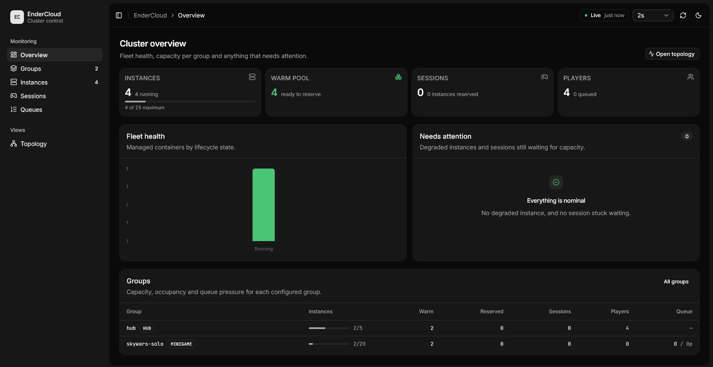

# EnderCloud

EnderCloud orchestrates Minecraft servers across Docker hosts. It keeps warm capacity, forms
minigame sessions without splitting parties, runs managed Velocity proxies and coordinates
player transfers. PostgreSQL stores control state; Redis delivers proxy notifications.



## Repository

| Path | Responsibility |
| --- | --- |
| `apps/orchestrator/` | Central configuration, placement, sessions, transfers, authentication and reconciliation |
| `apps/agent/` | Docker, ports, files, verified template cache and durable SQLite operation journal |
| `apps/dashboard/` | Authenticated Next.js operations console |
| `apps/web/` | Public website and Fumadocs publication |
| `packages/contracts/` | Browser-safe DTOs, enums, Zod schemas and HTTP transport |
| `packages/runtime/` | Shared server utilities |
| `plugins/{core,paper,velocity}/` | Java client, APIs and runtime bridges |
| `contracts/fixtures/` | Protocol fixtures shared with Java |
| `groups/`, `templates/` | Group policy and ordered server layers |
| `docs/guides/` | Canonical published documentation |

Applications have separate dependencies and images. The orchestrator owns all durable decisions;
agents do not access PostgreSQL, Redis or central configuration. One orchestrator is active per
database. Instance operations, registry revisions and player transfers are fenced against stale work.

## Install

Use Docker with Compose. For development use Bun **1.4.2**, Node.js **24.13.0** and JDK **25**.
The Gradle wrapper, dependency locks and verification hashes are included.

On Linux, `bash install.sh` generates a master, worker or combined deployment and initializes
credentials. For manual installation, follow the
[installation guide](docs/guides/getting-started/installation.mdx) and
[authentication guide](docs/guides/configure/authentication.mdx).

Copy `.env.example` to `.env`, set independent secrets and private addresses, then start
central services. Create the local administrator and provision each agent before enabling its
`agents` Compose profile. The console defaults to `http://127.0.0.1:3000/login`.
Serve it through HTTPS in production and keep control services on a private network.

The new release initializes an empty database or reopens its own schema. It explicitly refuses
legacy databases without modifying them. Retain existing data and use a separate database for
this release until an explicit migration is prepared.

Server templates require fixed compatible Paper/Velocity JARs and freshly built EnderCloud plugins.
After editing effective layers, increase the final variant revision and restart the orchestrator.

## Develop and validate

Install once from the root:

```bash
bun install --frozen-lockfile
bun run check
bun run browsers:install
bun run check:release
```

The quick check covers application boundaries, types, lint, formatting and unit tests. Release
validation adds disposable PostgreSQL/Redis integration tests, desktop/mobile browsers,
strict Java builds, all Docker images, installer checks and authenticated two-agent recovery.
Docker is required for those suites. See the
[test reference](docs/guides/develop/testing.mdx) for prerequisites and exact coverage.

Start applications with `bun run dev:orchestrator`, `dev:agent`, `dev:dashboard` or
`dev:web`. Demo dashboard data still requires a valid administrator session.

## Documentation

Guides are edited in `docs/guides/` and published directly by `apps/web`; there is no second
documentation snapshot.

- [Architecture](docs/guides/getting-started/architecture.mdx) and [concepts](docs/guides/getting-started/concepts.mdx)
- [Groups](docs/guides/configure/groups.mdx) and [variants](docs/guides/configure/variants.mdx)
- [Authentication](docs/guides/configure/authentication.mdx), [environment](docs/guides/configure/environment.mdx) and [multi-host deployment](docs/guides/configure/multi-host.mdx)
- [Dashboard](docs/guides/configure/dashboard.mdx), [agent](docs/guides/configure/agent.mdx) and [orchestrator](docs/guides/configure/orchestrator.mdx)
- [Development](docs/guides/develop/development.mdx), [tests](docs/guides/develop/testing.mdx) and [minigame integration](docs/guides/develop/minigame-integration.mdx)
- [Release work and validation evidence](docs/RELEASE_PROGRESS.md)

